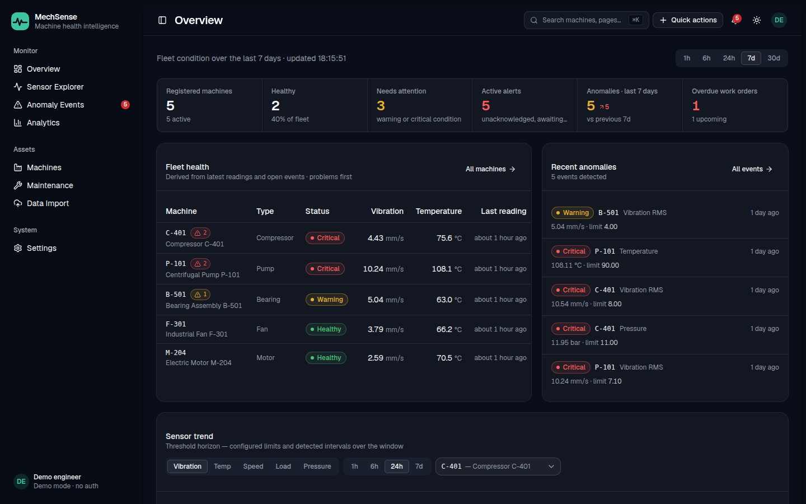
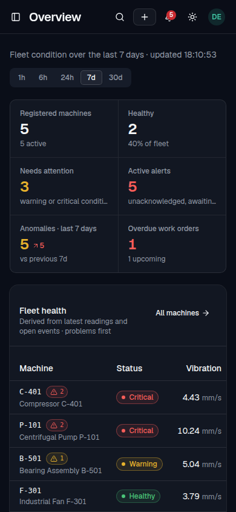
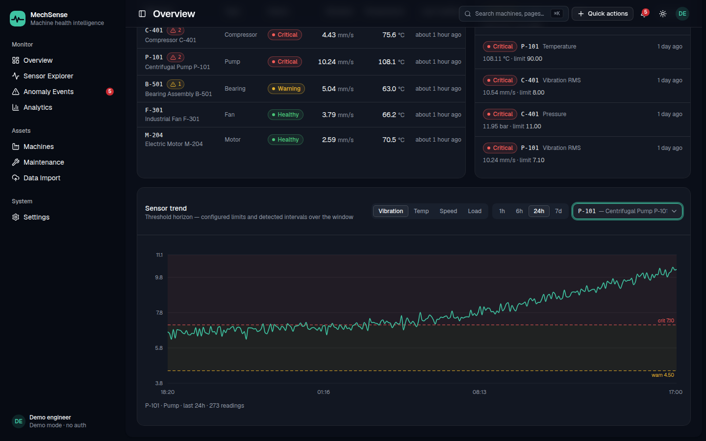

# MechSense

Industrial machine-health monitoring for pumps, motors, fans, compressors, and gearboxes.
MechSense ingests vibration, temperature, speed, load, and pressure readings, evaluates them
against per-machine engineering thresholds, groups violations into anomaly events, and supports
an acknowledge → resolve → work-order workflow.




> **Decision-support prototype — not certified condition-monitoring equipment.**
> The demo fleet and thresholds are synthetic and illustrative, not safety limits.

## Why this exists

Most CRUD dashboards do not understand the domain they display. MechSense is built around
mechanical-engineering semantics: vibration severity limits, thermal lag, load-speed-vibration
correlation, unit-aware values, and a detection lifecycle that distinguishes *reviewed* from
*resolved*. The goal is to show the full chain from sensor reading to human decision to
maintenance record, not just a chart.

## Status

| Area | Status |
|---|---|
| Backend API — machines, readings, detection, anomalies, maintenance, CSV imports, analytics, configuration | Implemented |
| Threshold detection — grouping, escalation, edge-triggered creation | Implemented |
| UI — Overview, Machines, Machine detail, Sensor Explorer, Anomaly feed, Anomaly detail | Implemented |
| UI — Maintenance, Data import, Analytics, Settings | Placeholder pages (backend endpoints exist) |
| Rolling statistical detection / Isolation Forest | Not implemented — reserved in the schema |
| Authentication | Not implemented — single-user demo scope |
| Container / hosted deployment | Not included — local run only |

## Features

- **Fleet overview** — health states, active alerts, period-over-period anomaly counts, and
  machines needing attention.
- **Machine registry** — equipment metadata and per-machine warning/critical thresholds.
- **Sensor explorer** — vibration, temperature, RPM, load, and pressure over 1 h / 6 h / 24 h / 7 d
  windows, with the latest reading and trend context.
- **Threshold detection** — critical beats warning, boundaries count (`>=`), missing or negative
  readings are skipped, only active machines are evaluated.
- **Anomaly lifecycle** — at most one active event per machine/metric/method; repeated violations
  extend and escalate the event; new events are created only on a fresh violation edge after the
  previous condition returns to normal. Acknowledgment and resolution are separate timestamps.
- **Maintenance API** — work orders with status, priority, scheduling, technician, findings, and
  linked anomaly events.
- **CSV import API** — preview and suggest a column mapping, validate with a dry run, import
  atomically, and review row-level errors.
- **Analytics API** — time-bucketed metric trends with average, min, max, p95, and per-machine
  series.
- **Deterministic demo data** — five seeded machines, roughly 10,000 readings over seven days,
  and pre-planted fault scenarios including a rising-vibration event on P-101.

## Architecture

```text
React 19 + Vite + TanStack Query
            │  REST /api/v1
            ▼
FastAPI + Pydantic v2  ──  threshold detector
            │
SQLAlchemy 2 + Alembic
            ▼
      PostgreSQL 16
```

```text
backend/
  app/api/v1/        machines, readings, anomalies, maintenance, imports, analytics
  app/detection/     threshold rules and event orchestration
  app/services/      application services
  app/repositories/  SQL queries
  app/models/        SQLAlchemy models and migrations
  tests/             124 tests
frontend/
  src/pages/         Overview, Machines, Machine detail, Sensor Explorer, Anomalies
  src/components/    charts, tables, filters, layout, shadcn/ui primitives
  src/api/           typed client, query hooks, API types
docs/screenshots/    overview, mobile, and threshold-horizon captures
```

## Quick start

Prerequisites: Python 3.12, [uv](https://docs.astral.sh/uv/), Node 24, and PostgreSQL 14+.

```bash
createdb mechsense
createdb mechsense_test

cd backend
uv sync --group dev
cp ../.env.example .env          # adjust DATABASE_URL if your Postgres uses TCP/password
uv run alembic upgrade head
uv run python -m scripts.seed
uv run uvicorn app.main:app --reload
```

API docs: <http://127.0.0.1:8000/docs>

```bash
cd frontend
npm ci
npm run dev
```

Console: <http://localhost:5173>. The Vite dev server proxies `/api` to the backend, so no
frontend environment variable is needed locally. For a split deployment, set
`VITE_API_BASE_URL`.

## Quality gates

```bash
cd backend
uv run ruff check .
uv run ruff format --check .
uv run pytest -q                 # 124 tests

cd ../frontend
npm run lint
npm run build
```

## API surface

| Method | Path | Purpose |
|---|---|---|
| GET | `/health` | Process health |
| GET/POST | `/api/v1/machines` | List / create machines |
| GET/PATCH | `/api/v1/machines/{id}` | Machine detail / update |
| GET/POST | `/api/v1/machines/{id}/readings` | Reading history / ingest |
| GET | `/api/v1/anomalies` | Filterable anomaly feed |
| GET | `/api/v1/anomalies/{id}` | Anomaly detail |
| POST | `/api/v1/anomalies/{id}/acknowledge` | Record review |
| POST | `/api/v1/anomalies/{id}/resolve` | Close event |
| GET/POST | `/api/v1/maintenance` | Work orders |
| GET/PATCH | `/api/v1/maintenance/{id}` | Work-order detail / lifecycle |
| POST | `/api/v1/imports/preview` | Parse CSV and suggest mapping |
| POST | `/api/v1/imports/csv` | Validate or import a mapped CSV |
| GET | `/api/v1/imports` | Import history |
| GET | `/api/v1/analytics/trends` | Bucketed metric trends |
| GET | `/api/v1/configuration` | Runtime configuration |

## Screenshots

| Mobile | Threshold horizon |
|---|---|
|  |  |

## Limitations and next steps

- The Maintenance, Data import, Analytics, and Settings **frontend pages are placeholders**.
  The corresponding backend endpoints are implemented and tested; the UI work is next.
- Only the transparent threshold detector ships. Rolling statistical detection and Isolation
  Forest are planned, not implemented.
- There is no authentication, role model, or audit trail.
- There is no container or deployment configuration; the app is verified locally only.
- Data is synthetic. Production use would require real sensor integration, calibration,
  alarm rationalization, and a safety review.

## License

MIT — see [LICENSE](LICENSE).
